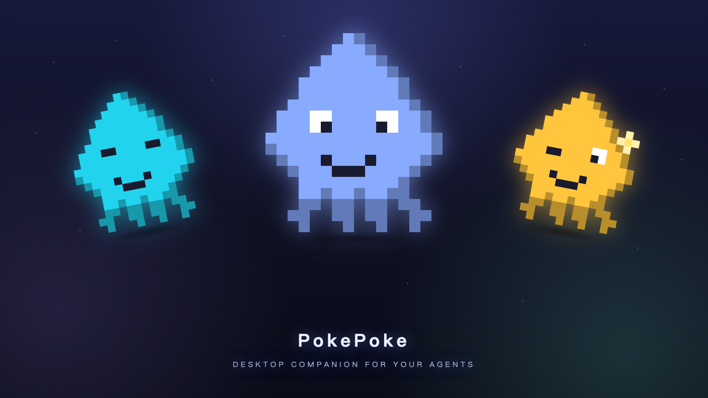
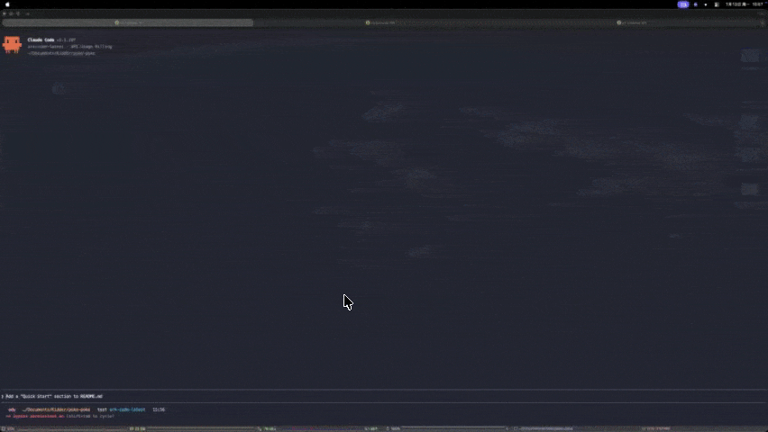

<div align="center">



# PokePoke

### Never miss the moment your coding agent needs you.

[中文](./README.md) | English

[**↓ Download for macOS**](https://github.com/hellokidder/PokePoke/releases/latest) · [**Website**](https://pokepoke.app) · [**Privacy**](https://pokepoke.app/privacy)


<a href="https://www.producthunt.com/products/pokepoke-agent-attention-for-macos?embed=true&utm_source=badge-featured&utm_medium=badge&utm_campaign=badge-pokepoke" target="_blank" rel="noopener noreferrer"></a>

<br />



</div>

---

A macOS menu-bar tool that aggregates hook events from **Claude Code / Cursor / Codex CLI / opencode / pi / omp / Kimi Code / DeepSeek Harness** into one place: one row per active session, corner popup + sound on state changes, click to jump back to the corresponding terminal / IDE window.

When agents run long tasks you don't have to babysit the screen — when they finish, wait for input, or hit an API error, the menu bar nudges you.

## How it works

| | Step | What happens |
|---|---|---|
| **1** | **Hook event** | PokePoke listens when your agent starts, waits, stops, or fails. |
| **2** | **Session state** | Running, pending, idle, and failed sessions stay visible in the menu-bar panel. |
| **3** | **Nudge** | A corner popup + system alert sound bring the moment back to you. |
| **4** | **Jump back** | Click the popup or press `⌘N` to return to the exact terminal or IDE window. |

The popup **stays on screen until you act** — switch spaces, grab coffee, come back, it's still there. That's the whole bet: less elegant than a fade-out, much harder to ignore.

## Requirements

- macOS 13 (Ventura) or newer
- Apple Silicon (arm64). No official Intel build yet — build it yourself with `pnpm tauri build`
- One of: Claude Code / Cursor / Codex CLI / opencode / pi / omp / Kimi Code / DeepSeek Harness

## Install

1. Download the latest `PokePoke_<version>_aarch64.dmg` from [Releases](../../releases)
2. Mount it and drag PokePoke.app into `/Applications`
3. On first launch macOS may say "cannot verify developer" — go to `System Settings → Privacy & Security` and click "Open Anyway" at the bottom
4. A purple octopus icon in the menu bar means you're good

## Building from source

```bash
pnpm install
pnpm tauri dev            # dev mode: hot reload, unsigned, just works

# build a runnable local .app (unsigned, no updater artifacts)
pnpm tauri build --bundles app \
  --config '{"bundle":{"macOS":{"signingIdentity":null},"createUpdaterArtifacts":false}}'
# output: src-tauri/target/release/bundle/macos/PokePoke.app
```

Requires macOS + Rust stable + Node 24 + pnpm 10. The project is mac-only: `cfg(target_os = "macos")` is
sprinkled through popup / tray / hook deployment, and Linux / Windows fail even `cargo check`.

**Why the `--config` flag**: the checked-in `tauri.conf.json` pins the maintainer's Developer ID
signing identity and enables updater artifact signing — both only exist on the maintainer's machine
and in CI. Without overriding them:

| Command | Result |
|---|---|
| `pnpm tauri build` | ❌ fails at `failed to sign app` (cert not in your keychain) |
| override `signingIdentity`, keep default targets | ⚠️ `.app` builds, `.dmg` step (`bundle_dmg.sh`) fails on an unsigned app |
| `--bundles app` + the `--config` above | ✅ produces `PokePoke.app`, double-click to run (unsigned, macOS warns once) |

Official releases use plain `pnpm tauri build` with a real certificate, injected by CI.

## Connect an agent

### Claude Code

Menu bar icon → **Claude Code: Connect** → writes `~/.claude/settings.json` in one click and starts receiving SessionStart / UserPromptSubmit / Notification / Stop / StopFailure events. Disconnect / Repair are in the same menu.

When the hook protocol is upgraded later, the panel header shows a "Hook config out of date" warning with a one-click fix button — click it and the latest version is rewritten to settings.json.

### Cursor

Menu bar icon → **Cursor: Connect** → writes `~/.cursor/hooks.json` (user-level global, not per project). Receives sessionStart / beforeSubmitPrompt / stop / sessionEnd events.

> **Note**: if you also enable *Third-party hooks* in Cursor (which makes Cursor read `~/.claude/settings.json`), Cursor events will fire twice. Poke Poke has a 100ms in-memory dedupe on the backend as a safety net, but pick one.

### Codex CLI

Menu bar icon → **Codex CLI: Connect** → writes `~/.codex/hooks.json` + `~/.codex/config.toml` in one click and starts receiving SessionStart / UserPromptSubmit / Stop events. Poke Poke automatically enables `[features] codex_hooks = true`, but Codex hooks remain a Codex-side feature flag — stability follows the current Codex CLI release.

> **Codex CLI ≥0.131 requires a one-time hook trust step**: after Connect or any Codex upgrade, run `codex` (TUI), type `/hooks`, and trust the `poke-hook` entry. Without this, Codex silently skips the hook — no PokePoke popups, and `codex exec` hangs at the trust confirmation.

Codex doesn't currently have Notification / StopFailure hooks, so `pending` and `last_failed` can't be expressed as fully as with Claude Code.

### opencode

Menu bar icon → **opencode: Connect** → drops a JS plugin at `~/.config/opencode/plugins/pokepoke.js` (user-level, honors `XDG_CONFIG_HOME`) in one click; no opencode restart needed. The plugin subscribes to opencode events and forwards them to PokePoke: `session.created` / user prompt → Running, `session.idle` → Idle, `permission.updated` (awaiting approval) → Pending, `session.error` → last_failed.

> opencode is the **only** integration besides Claude Code that can natively raise `last_failed` (API/provider errors). opencode runs in a terminal like cc/codex, so it supports precise Ghostty terminal_id focus on click (the first jump triggers a one-time macOS permission prompt — click Allow).
>
> If you've overridden opencode's config root via `OPENCODE_CONFIG_DIR`, one-click Connect won't cover that case — place `pokepoke.js` under the corresponding `plugin/` manually.

### pi

Menu bar icon -> **pi: Connect** -> drops a TS extension at `~/.pi/agent/extensions/pokepoke/` (auto-discovered by pi; your `~/.pi/agent/settings.json` is untouched); requires pi ≥ 0.80.10. The extension subscribes to pi events and forwards them to PokePoke: `session_start` / `before_agent_start` (user prompt) -> Running, `agent_settled` -> Idle, `session_shutdown` -> session end.

> pi only reports in interactive TUI mode (`ctx.mode === "tui"`); `print` / `rpc` / `json` modes have no pane to jump to and are not tracked. pi has no native permission popup, so there is no `pending` state — by design, not a gap. The extension swallows all of its own errors, so a `poke-hook` fault never leaks into pi's main loop.

### omp (Oh My Pi)

Menu bar icon -> **omp: Connect** -> drops a TS extension at omp's agent dir (default `~/.omp/agent/extensions/pokepoke/`, auto-discovered by omp; honors `PI_CODING_AGENT_DIR` / `OMP_PROFILE` / `PI_PROFILE`, matching omp's own resolution). omp is a fork of pi: same mechanism, different event catalog — `session_start` / `before_agent_start` (user prompt) -> Running, `agent_end` (`willContinue !== true`) -> Idle, `session_shutdown` -> session end.

> omp has no `agent_settled` event (PokePoke decides settle via `agent_end` + `willContinue`). omp's native `tool_approval_requested` raises `pending` (same as Claude Code's permission prompt). One omp process can host both the main session and subagent sessions — the extension filters subagent sessions, and `/new` / `/resume` / `/fork` closes the old session and re-registers the new one. If `PI_CODING_AGENT_DIR` points at pi's agent dir (both hosts sharing one extension file), Connect for omp is refused instead of overwriting pi's integration.

### DeepSeek Harness

**Settings → Integrations** → DeepSeek Harness → **Connect** → drops a `pokepoke-dsh` cordis plugin into every
existing DSH web profile (`~/.dsh/profiles/desktop`, `web`) and appends a managed block to that profile's
`cordis.patch.yml`. The plugin has two halves: the host half subscribes to `session/event` and forwards it via
`poke-hook --source=dsh`; the client half calls `uiWorkspace.openSession` inside the renderer — DSH has no
per-session deep link, so this is the only precise way to jump back to a specific conversation.

Event mapping: `turn/start` → Running, `approval/asked` / in-flight user questions → Pending,
`turn/end` (completed / aborted / error / max-tokens…) → Idle / aborted / last_failed.

> The plugin loads under HMR right after the first Connect, so usually no restart is needed; after upgrading the
> plugin (especially the client half) reload the DSH window once (⌘R). The plugin only adds or removes its own
> managed block and leaves your other plugin lines alone; DSH must have been launched at least once and have a
> web profile before it can be connected.

## Terminal hosts & focus

Clicking a popup (or pressing `⌘N`) jumps to the terminal window of the corresponding session. Supported hosts:

- **iTerm2** / **Terminal.app** — matched by tty; cross-space / cross-window jumps are handled automatically
- **Ghostty 1.3+** (0.0.5+) — at SessionStart time, PokePoke captures Ghostty's stable terminal id via AppleScript and stores it on the session; later jumps use the id for precise targeting, so even multiple tabs running different agents in the same cwd all jump correctly. **The first jump triggers a one-time macOS prompt "PokePoke wants to control Ghostty" — click Allow** (same as the first jump to iTerm2 / Terminal.app; macOS asks once per app, globally). Ghostty < 1.3 has no AppleScript dictionary, so jump falls back to opening the cwd in Finder
- **WezTerm** — the hook captures `WEZTERM_PANE` + `WEZTERM_UNIX_SOCKET`; clicks short-circuit through `wezterm cli activate-pane` to the exact pane
- **Otty** — the hook captures `OTTY_PANE_ID` (identified via `TERM_PROGRAM=otty`); clicks short-circuit through the `otty pane` CLI to the exact pane
- **Orca** (onorca.dev) — the hook captures `ORCA_PANE_KEY` + `ORCA_WORKTREE_ID`; clicks focus the pane via `orca terminal switch`; includes host discovery for Orca embedded in herdr
- **Cursor built-in terminal** — uses the `cursor <workspace>` CLI to reuse an existing window

## Settings panel

Click the menu-bar icon to expand the panel; the gear icon at the bottom-right opens settings:

- **Alert sound**: any system sound / mute
- **Language**: Chinese / English
- **Tray icon**: colored octopus / fixed white (visible on dark menu bars, nearly invisible on light — this is a trade-off, not a bug)
- **Popup position**: any of the 4 screen corners; popups slide in / stack from that corner

The toggle at the bottom-left of the panel is the master "Notifications" switch — turn it off and state changes are still recorded silently with no popup or sound.

## Quit

- ⏻ icon at the top-right of the panel
- Or menu-bar icon → Quit

## Contributing

- **Issues are welcome** — bug reports, feature requests, usage questions.
- **Pull requests are not accepted**: this repo is a one-way mirror of an internal
  development repo, so anything merged here would be overwritten on the next release.
  Please open an issue instead; fixes land in the internal repo and ship with the next
  version (with credit).

## Data & Privacy

- All data lives locally under `~/.pokepoke/`: `sessions.json` (current sessions), `settings.json` (user preferences), `pokepoke.log` (rolling log, INFO by default; set `POKEPOKE_DEBUG=1` for DEBUG)
- Pre-write snapshots in `~/.pokepoke/snapshots/` (last 5 per source, manual restore)
- Hook ↔ server runs over a Unix Domain Socket at `~/.pokepoke/sock`. No network ports are opened, no external services contacted.
- **PokePoke makes no outbound calls at all** — no hook content, prompts, session data, or local logs ever leave your Mac. No account, no telemetry, no license check.

## Uninstall

```bash
# the app itself
rm -rf /Applications/PokePoke.app

# data (optional)
rm -rf ~/.pokepoke

# hook binary
rm -f ~/.local/bin/poke-hook

# Each agent's hook config — using the menu-bar Disconnect is safest;
# or manually edit ~/.claude/settings.json, ~/.codex/hooks.json,
# ~/.codex/config.toml and ~/.cursor/hooks.json
# and remove entries containing "poke-hook".
# pi extension dir: rm -rf ~/.pi/agent/extensions/pokepoke
```

## License

- **MIT** — see [LICENSE](LICENSE). Use it, modify it, redistribute it, including commercially.
- **Every feature is free** — no paid tier, no feature gate, no daily quota. No data collection, no account required.
- **The name and logo are not covered** — `PokePoke` and the octopus icon may not be used for your fork or derivative distribution. See [TRADEMARK.md](TRADEMARK.md).
- If it saves you time, a star is welcome; a donation option will open later (it won't gate any feature).
