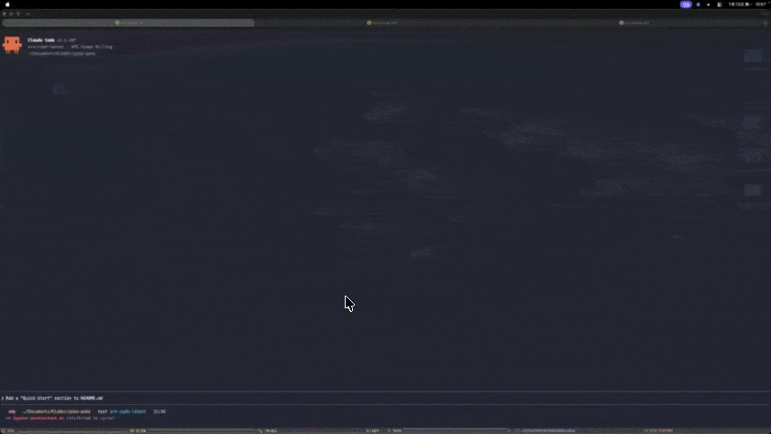

<div align="center">


# PokePoke

### Never miss the moment your coding agent needs you.

中文 | [English](./README.en.md)

[**↓ 下载 macOS 版**](https://github.com/hellokidder/PokePoke/releases/latest) · [**官网**](https://pokepoke.app) · [**隐私政策**](https://pokepoke.app/privacy)


<a href="https://www.producthunt.com/products/pokepoke-agent-attention-for-macos?embed=true&utm_source=badge-featured&utm_medium=badge&utm_campaign=badge-pokepoke" target="_blank" rel="noopener noreferrer"></a>

<br />



</div>

---

macOS 菜单栏小工具,把 **Claude Code / Cursor / Codex CLI / opencode / pi / omp / Kimi Code / DeepSeek Harness** 跑出的 hook 事件聚合到一处:每个活跃会话一行,状态变化时弹角 popup + 提示音,点一下跳回对应终端 / IDE 窗口。

agent 跑长任务时不用守在屏幕前——出活了 / 等用户输入了 / API 报错了,菜单栏会主动提醒。

## 工作方式

| | 步骤 | 发生什么 |
|---|---|---|
| **1** | **hook 事件** | agent 启动 / 等输入 / 结束 / 失败时,PokePoke 收到事件 |
| **2** | **会话状态** | running / pending / idle / failed 四态在菜单栏面板里常驻可见 |
| **3** | **提醒** | 角标 popup + 系统提示音,把这一刻拉回你的注意力 |
| **4** | **回跳** | 点 popup 或按 `⌘N`,直接切回那个终端 / IDE 窗口 |

popup **不会自动消失**——切 space、去倒杯咖啡、回来它还在。这是有意的:比"优雅的淡出"难忽略得多。

## 系统要求

- macOS 13 (Ventura) 及以上
- Apple Silicon (arm64)。Intel Mac 暂未官方打包,可自己 `pnpm tauri build`
- Claude Code / Cursor / Codex CLI / opencode / pi / omp / Kimi Code / DeepSeek Harness 任选其一

## 安装

1. 从 [Releases](../../releases) 下载最新 `PokePoke_<version>_aarch64.dmg`
2. 双击挂载,把 PokePoke.app 拖进 `/Applications`
3. 第一次启动时,macOS 可能弹「无法验证开发者」——`系统设置 → 隐私与安全性`,在最下面允许打开
4. 启动后菜单栏出现紫色八爪鱼图标即就绪

## 从源码构建

```bash
pnpm install
pnpm tauri dev            # 开发模式:热更新,不签名,随便改

# 打一个本地可运行的 .app(不签名、不产 updater 产物)
pnpm tauri build --bundles app \
  --config '{"bundle":{"macOS":{"signingIdentity":null},"createUpdaterArtifacts":false}}'
# 产物:src-tauri/target/release/bundle/macos/PokePoke.app
```

需要 macOS + Rust stable + Node 24 + pnpm 10。项目是 mac-only:`cfg(target_os = "macos")` 遍布
popup / tray / hook 部署,Linux / Windows 连 `cargo check` 都过不了。

**为什么打 `--config`**:仓库里的 `tauri.conf.json` 写死了维护者的 Developer ID 签名身份,
并开启了 updater 签名产物 —— 这两样只有维护者机器和 CI 上有。不覆盖的话:

| 命令 | 结果 |
|---|---|
| `pnpm tauri build` | ❌ 打包阶段 `failed to sign app`(证书不在你的 keychain) |
| 覆盖 `signingIdentity` 但保留默认 targets | ⚠️ `.app` 成功,`.dmg` 那步(`bundle_dmg.sh`)对未签名 app 失败 |
| `--bundles app` + 上面的 `--config` | ✅ 出 `PokePoke.app`,可直接双击运行(未签名,首次启动系统会提醒) |

正式发版用的是带证书的 `pnpm tauri build`,由 CI 注入 `APPLE_*` 与 `TAURI_SIGNING_PRIVATE_KEY`。

## 接入 agent

### Claude Code

菜单栏图标 → **Claude Code: Connect** → 一键写入 `~/.claude/settings.json`,即可接收 SessionStart / UserPromptSubmit / Notification / Stop / StopFailure 事件。Disconnect / Repair 也在同一菜单。

未来升级 hook 协议时,panel 顶部会显示「Hook 配置过期」告警 + 一键修复按钮——点一下就重写最新版本到 settings.json。

### Cursor

菜单栏图标 → **Cursor: Connect** → 一键写入 `~/.cursor/hooks.json`(用户级全局,不按项目)。接收 sessionStart / beforeSubmitPrompt / stop / sessionEnd 事件。

> **注意**:如果你在 Cursor 里同时开启了 *Third-party hooks*(会让 Cursor 读 `~/.claude/settings.json`),Cursor 事件会触发两次。Poke Poke 后端有 100ms 内存去重兜底,但建议二选一。

### Codex CLI

菜单栏图标 → **Codex CLI: Connect** → 一键写入 `~/.codex/hooks.json` + `~/.codex/config.toml`,即可接收 SessionStart / UserPromptSubmit / Stop 事件。Poke Poke 会自动启用 `[features] codex_hooks = true`,但 Codex hooks 仍属于 Codex 侧 feature flag 能力,稳定性以 Codex CLI 当前版本为准。

> **Codex CLI ≥0.131 需要手动信任一次 hook**:Connect / 升级 Codex 后,打开 `codex` 进 TUI → 输入 `/hooks` → 把 `poke-hook` 那条 trust 掉。没做这步的话 Codex 会静默不 fire hook,PokePoke 也就不会有任何弹窗,且 `codex exec` 会卡在 trust 确认上。

Codex 当前没有 Notification / StopFailure hook,所以 `pending` 和 `last_failed` 不能像 Claude Code 一样完整表达。

### opencode

菜单栏图标 → **opencode: Connect** → 一键投放一个 JS plugin 到 `~/.config/opencode/plugins/pokepoke.js`(用户级,遵循 `XDG_CONFIG_HOME`),写入后无需重启 opencode。plugin 订阅 opencode 事件并转发给 PokePoke,映射:`session.created` / 用户提交 prompt → Running,`session.idle` → Idle,`permission.updated`(等审批)→ Pending,`session.error` → last_failed。

> opencode 是除 Claude Code 外**唯一**能原生触发 `last_failed`(API/provider 报错)的接入端。opencode 与 cc/codex 一样在终端里跑,支持 Ghostty terminal_id 精准回跳(首次跳转会触发一次 macOS 授权提示,点允许即可)。
>
> 若你设置了 `OPENCODE_CONFIG_DIR` 整体改写了 opencode 的 config 目录,一键接入不覆盖该场景,需手动把 `pokepoke.js` 放到对应的 `plugin/` 下。

### pi

菜单栏图标 -> **pi: Connect** -> 一键投放一个 TS 扩展到 `~/.pi/agent/extensions/pokepoke/`(pi 自动发现,不碰 `~/.pi/agent/settings.json`),要求 pi ≥ 0.80.10。扩展订阅 pi 事件并转发给 PokePoke,映射:`session_start` / `before_agent_start`(用户提交 prompt)-> Running,`agent_settled` -> Idle,`session_shutdown` -> 会话结束。

> pi 仅在交互式 TUI 模式(`ctx.mode === "tui"`)下上报;`print` / `rpc` / `json` 模式无 pane 可跳,不跟踪。pi 没有原生审批弹窗,因此没有 `pending` 状态——这是设计如此,不是缺口。扩展内部吞掉所有异常,`poke-hook` 自身故障不会泄进 pi 主流程。

### omp(Oh My Pi)

菜单栏图标 -> **omp: Connect** -> 一键投放一个 TS 扩展到 omp 的 agent 目录(默认 `~/.omp/agent/extensions/pokepoke/`,omp 自动发现;honor `PI_CODING_AGENT_DIR` / `OMP_PROFILE` / `PI_PROFILE`,与 omp 自身解析一致)。omp 是 pi 的 fork,接入机制同族但事件目录不同:映射 `session_start` / `before_agent_start`(用户提交 prompt)-> Running,`agent_end`(`willContinue !== true`)-> Idle,`session_shutdown` -> 会话结束。

> omp 没有 pi 的 `agent_settled` 事件(PokePoke 用 `agent_end` + `willContinue` 判定 settle)。omp 独有的 `tool_approval_requested` 会弹 `pending`(等价 Claude Code 的权限确认)。omp 一个进程里可能同时跑主 session 与 subagent 子 session,扩展会过滤子 session;`/new` / `/resume` / `/fork` 换 session 时自动给旧会话收尾并重建。若你把 `PI_CODING_AGENT_DIR` 指到 pi 的 agent 目录(两个宿主共用同一份扩展),omp 侧 Connect 会被拒绝,而不是覆盖 pi 的接入。

### Kimi Code

菜单栏图标 -> **Kimi Code: Connect** -> 一键向 `~/.kimi-code/config.toml` 的 `[[hooks]]` 注入 poke-hook(Kimi 的 hook 契约与 Claude Code 一致:同名事件 + stdin JSON + exit 2 block),即可接收 SessionStart / UserPromptSubmit / Stop / StopFailure / PermissionRequest 事件。接入只增删我们自己的 `[[hooks]]` 条目(按 `command` 子串识别,不留标记字段以免触发 Kimi 严格 schema),用户的 providers / models / `[thinking]` 等配置与注释原样保留;写后用 `kimi doctor config` 回环校验,失败自动回滚。honor `KIMI_CODE_HOME`。

> Kimi 把"工具待审批"拆成了独立的 `PermissionRequest` 事件(对应 Claude Code 的 `Notification.permission_prompt`),接入后待审批会弹 `pending`。`Notification` 事件暂未纳入(避免与 `Stop` 同时 fire 双弹窗),后续视真机 firing 样本再补;`--yolo` / `--auto` 模式不 fire `PermissionRequest`。

### DeepSeek Harness

**设置 → 接入端** → DeepSeek Harness → **Connect** → 向每个已存在的 DSH web profile(`~/.dsh/profiles/desktop`、`web`)投放 `pokepoke-dsh` cordis 插件包,并在该 profile 的 `cordis.patch.yml` 追加一条 managed block。插件分 host / client 两半:host 半订阅 `session/event` 并经 `poke-hook --source=dsh` 转发;client 半在渲染进程里执行 `uiWorkspace.openSession` —— DSH 没有 per-session deep link,这是"点一下直接切回那条对话"的唯一精确入口。

事件映射:`turn/start` → Running,`approval/asked` / 进行中的用户提问 → Pending,`turn/end`(completed / aborted / error / max-tokens…)→ Idle / aborted / last_failed。

> 首次 Connect 后 DSH 会在 HMR 下直接加载插件,通常无需重启;升级插件版本(尤其 client 半)后需要重载一次 DSH 窗口(⌘R)。插件只增删自己的 managed block,不碰用户其它插件行;DSH 至少启动过一次、存在 web profile 才能接入。

## 终端宿主与跳转

点击 popup / 按 `⌘N` 跳到对应 session 的终端窗口。支持的宿主:

- **iTerm2** / **Terminal.app** —— 按 tty 精准匹配 tab,跨 space / window 自动 follow
- **Ghostty 1.3+**(0.0.5+)—— SessionStart 时通过 AppleScript 抓 stable terminal id 存 session,后续按 id 精准跳。即便多个 tab 在同一 cwd 下跑不同 agent,也能跳到对的那个。**首次跳转时 macOS 会弹一次"PokePoke wants to control Ghostty"授权,点允许即可**(跟 iTerm2 / Terminal.app 第一次跳转一样,系统全局只问一次)。Ghostty < 1.3 没有 AppleScript dictionary → 跳转退化为打开 cwd 文件夹
- **WezTerm** —— hook 采集 `WEZTERM_PANE` + `WEZTERM_UNIX_SOCKET`,点击经 `wezterm cli activate-pane` 精准回跳对应 pane
- **Otty** —— hook 采集 `OTTY_PANE_ID`(`TERM_PROGRAM=otty` 识别),点击经 `otty pane` CLI 精准回跳对应 pane
- **Orca**(onorca.dev)—— hook 采集 `ORCA_PANE_KEY` + `ORCA_WORKTREE_ID`,点击经 `orca terminal switch` 精准聚焦对应 pane;支持 herdr 内嵌 Orca 的宿主发现
- **Cursor 内置终端** —— 走 `cursor <workspace>` CLI 复用既有窗口

## 设置面板

点菜单栏图标展开 panel,右下角齿轮图标打开设置:

- **提示音**:任意系统音 / 静音
- **语言**:中文 / English
- **菜单栏图标**:彩色八爪鱼 / 固定白色(深色菜单栏可见,浅色菜单栏几乎隐形——这是 trade-off,不是 bug)
- **提示窗位置**:屏幕 4 角任选,popup 从对应角弹出 / 堆叠

panel 左下角 toggle 是「全局提示」总开关——关掉后状态变化只静默记录,不弹 popup 不放音。

## 退出

- panel 右上角 ⏻ 关机图标
- 或菜单栏图标 → Quit

## 参与方式

- **Issue 欢迎**：bug 报告、功能建议、使用问题都请[开 issue](https://github.com/hellokidder/PokePoke/issues)。
- **不接受 Pull Request**：本仓的源码由内部仓单向同步，直接合并的 PR 会在下次发版被覆盖。
  修复请提 issue，我在内部仓合并后随版本发布（署名保留）。

## 数据 & 隐私

- 所有数据本地存在 `~/.pokepoke/` 下:`sessions.json`(当前会话)、`settings.json`(用户偏好)、`pokepoke.log`(滚动日志,默认 INFO 级,设 `POKEPOKE_DEBUG=1` 启 DEBUG)
- hook 写前 snapshot 在 `~/.pokepoke/snapshots/`(每个 source 保留最近 5 份,手动复原用)
- Hook ↔ server 走 Unix Domain Socket `~/.pokepoke/sock`,不开任何网络端口,不与外部服务通信
- **PokePoke 自身完全不联网**——不上传 hook 内容、prompt、session 信息或本地日志;没有账号、没有遥测、没有授权校验。

## 卸载

```bash
# app 本身
rm -rf /Applications/PokePoke.app

# 数据(可选)
rm -rf ~/.pokepoke

# hook binary
rm -f ~/.local/bin/poke-hook

# 各 agent 的 hook 配置,自己用菜单栏 Disconnect 清更稳;
# 或手动编辑 ~/.claude/settings.json、~/.codex/hooks.json、
# ~/.codex/config.toml 与 ~/.cursor/hooks.json
# 把含 "poke-hook" 的条目删掉。
# pi 扩展目录:rm -rf ~/.pi/agent/extensions/pokepoke
```

## License & 授权

- **MIT** —— 见 [LICENSE](LICENSE)。可自由使用、修改、再分发,包括商业用途。
- **全功能免费**：没有付费档、没有功能门禁、没有每日配额;不收集数据、不要求账号。
- **商标不在授权范围内** —— `PokePoke` 这个名字和八爪鱼图标不能用于你的 fork / 衍生发行版,详见 [TRADEMARK.md](TRADEMARK.md)。
- 如果你觉得它有用,欢迎 star。
