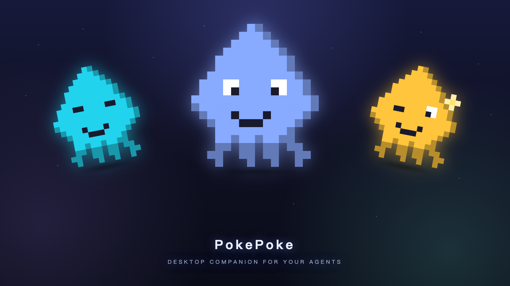

# PokePoke

### Never miss the moment your coding agent needs you.

PokePoke is a macOS menu-bar tool that watches **Claude Code**, **Cursor**, **Codex**, **opencode**, **pi**, **omp**, **Kimi Code**, and **Grok Build** from your menu bar — then nudges you when a session is waiting, done, or stuck.

[**↓ Download for macOS**](https://github.com/hellokidder/PokePoke/releases/latest) · [**Website**](https://pokepoke.app) · [**Privacy**](https://pokepoke.app/privacy) · [**Terms**](https://pokepoke.app/terms)

 

---

## The problem

Agents run ahead. You start one, switch to another task, and come back twenty minutes later to find it was waiting the whole time. PokePoke turns those stalled moments into visible, audible attention signals — so you stop babysitting terminals.

## How it works

PokePoke is built around one loop:

| | Step | What happens |
|---|---|---|
| **1** | **Hook event** | PokePoke listens when your agent starts, waits, stops, or fails. |
| **2** | **Session state** | Running, pending, idle, and failed sessions stay visible in the menu bar. |
| **3** | **Nudge** | A corner popup + system alert sound bring the moment back to you. |
| **4** | **Jump back** | Click the alert or press `⌘N` to return to the exact terminal or IDE window. |

The popup **stays on screen until you act** — switch spaces, grab coffee, come back, it's still there. That's the whole bet: less elegant than a notch animation, much harder to ignore.

## Why PokePoke

- **Stop babysitting terminals** — start an agent, walk away. PokePoke brings you back the moment it needs you, instead of the other way around.
- **The nudge that doesn't disappear** — popups stay until you act, so a "waiting for your input" that lands while you're in another app doesn't get lost in a notification stack.
- **One click back to the action** — click the alert and you're in the exact terminal window, right where your agent is stuck.
- **Quiet until it matters** — no dashboard, no cloud, no accounts. It only speaks up when your agent does.

## Integrations

Connect the agents you already use. PokePoke writes user-level hook config and keeps every signal in one menu-bar panel.

| Agent | Hooks |
|---|---|
| **Claude Code** | `SessionStart` / `UserPromptSubmit` / `Notification` / `Stop` / `StopFailure` |
| **Cursor** | `sessionStart` / `beforeSubmitPrompt` / `stop` / `sessionEnd` |
| **Codex CLI** | `SessionStart` / `UserPromptSubmit` / `Stop` |
| **opencode** | `session.created` / `session.idle` / `permission.updated` / `session.error` |
| **pi** | `session_start` / `before_agent_start` / `agent_settled` / `session_shutdown` |
| **omp** (Oh My Pi) | `session_start` / `before_agent_start` / `agent_end` / `tool_approval_requested` / `session_shutdown` |
| **Kimi Code** | `SessionStart` / `UserPromptSubmit` / `Stop` / `StopFailure` / `PermissionRequest` |
| **Grok Build** | `SessionStart` / `UserPromptSubmit` / `Notification` / `Stop` / `StopFailure` / `SessionEnd` |

Each integration connects per-agent from the menu bar in one click. PokePoke only adds or removes its own hook entries — the rest of your config is left untouched.

**Terminal jump** lands on the right window — not just any terminal.

- **iTerm2** / **Terminal.app** — matched by `tty`
- **Ghostty 1.4+** — matched by the native `tty` property, so multiple tabs or splits in the same directory still jump to the exact pane. **Ghostty 1.3** falls back to the stable terminal id captured at session start. The first jump triggers a one-time macOS prompt "PokePoke wants to control Ghostty" — click Allow
- **WezTerm** (`WEZTERM_PANE`) / **otty** (`OTTY_PANE_ID`) / **Orca** (`ORCA_PANE_KEY`) / **herdr** / **cmux** / **tmux** — jump straight to the exact pane
- **Warp** — brings the window forward (Warp exposes no scriptable pane lookup)
- **Cursor** — opens the matching workspace

## Privacy — local-first

Everything PokePoke tracks lives on your machine under `~/.pokepoke/`. Hooks talk to the app over a local Unix socket.

- All session data stays on-device. Nothing is sent to our servers.
- No prompts, no logs, no code, no terminal output ever leaves your Mac.
- No account, no sign-in. The only outbound call is license activation with [Creem](https://www.creem.io).

## Pricing

| | Free | Pro |
|---|---|---|
| Desktop notifications | Up to 20 / day | **Unlimited** |
| Terminal jump | Basic | **Unlimited** |
| Integrations | All | All |

**Pro** — $1.99/mo or $14.99 one-time lifetime (regular $19.99). License activation is handled through Creem; the key is stored in the macOS Keychain.

→ [Get Pro at pokepoke.app](https://pokepoke.app/#pricing)

## Install

1. [Download the latest `.dmg`](https://github.com/hellokidder/PokePoke/releases/latest) — macOS 13 (Ventura) or newer, Apple Silicon.
2. Open it and drag PokePoke to Applications.
3. Launch PokePoke — it lives in your menu bar. Connect your agents from the panel.

Updates are delivered in-app via the built-in updater.

---

> **Enjoying PokePoke? ⭐ Star this repository** — it helps more developers never miss their agent's moment.

## Links

- **Website:** [pokepoke.app](https://pokepoke.app)
- **Releases:** [github.com/hellokidder/PokePoke/releases](https://github.com/hellokidder/PokePoke/releases)
- **Privacy Policy:** [pokepoke.app/privacy](https://pokepoke.app/privacy)
- **Terms of Service:** [pokepoke.app/terms](https://pokepoke.app/terms)
- **Refund Policy:** [pokepoke.app/refund](https://pokepoke.app/refund)
- **Contact:** hellokiddermail@gmail.com

---

This repository hosts binary releases. PokePoke's source code is proprietary.

